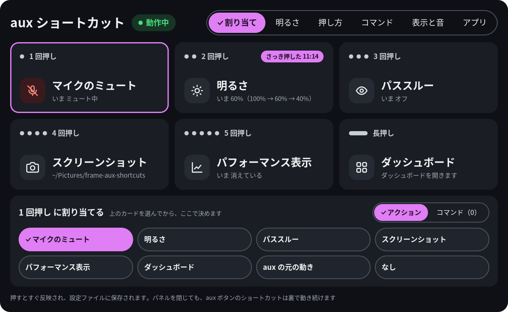
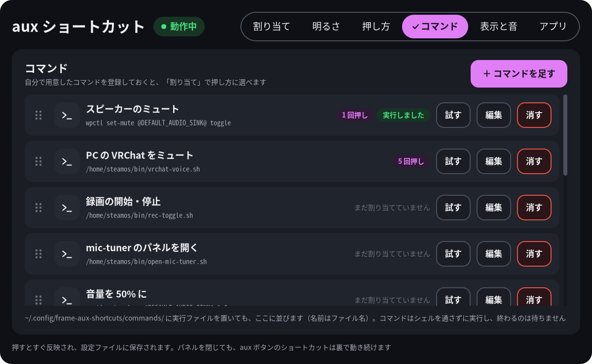
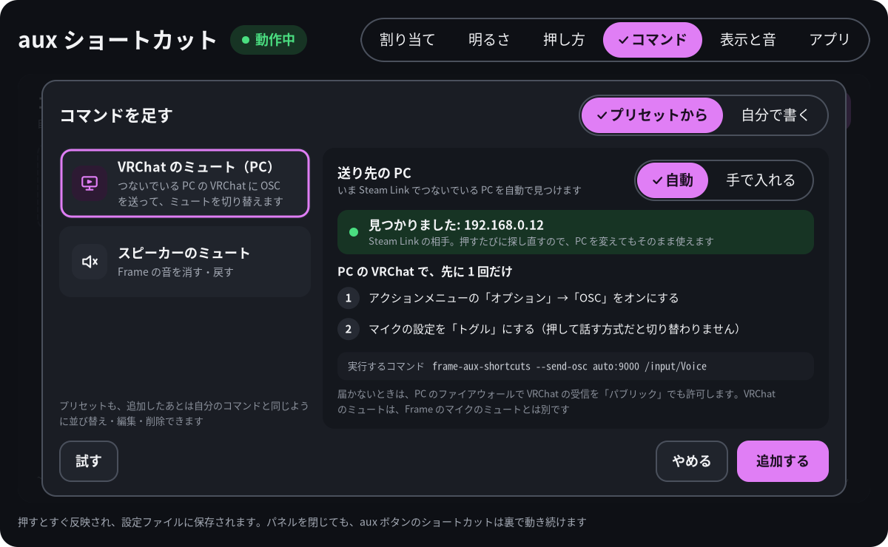

# frame-aux-shortcuts

Steam Frame の **aux ボタン**（電源ボタンの上の小さなボタン）を、ショートカットキーとして使うアプリです。1〜5 回押しと長押しの 6 つの押し方に、それぞれアクションを割り当てられます: マイクのミュート、明るさの段の切り替え、パススルーのオン・オフ、スクリーンショット、[frame-perf-overlay](https://github.com/sasaken1102r/frame-perf-overlay) の表示・非表示、ダッシュボードを開く、aux の元の動き、自分で登録したコマンドの実行。押すと短い音と視界の小さなお知らせで、何をしたかが分かります。設定はすべて SteamVR ダッシュボードのタブから。ヘッドセット本体の上で動き、sudo は要りません。

[English](README.md)

> **非公式のツールです。** Valve とは関係ありません。パススルーの切り替えは SteamVR の非公開の仕組みに頼っているので、SteamVR の更新で動かなくなることがあります。自己責任で使ってください。




画像はヘッドセットの中で撮ったものではなく、プログラム自身が書き出したものです。画像の中の状態・時刻・コマンド・IP アドレスはダミーの値です。

## できること

| 押し方 | 決まるとき | 既定のアクション |
|---|---|---|
| 1〜5 回押し | 離してから 0.35 秒、次に押さなかったとき | 1: マイクのミュート、2: 明るさ、3: パススルー、4: スクリーンショット、5: パフォーマンス表示 |
| 長押し | 0.6 秒押し続けた時点 | ダッシュボード |

6 回以上押したときは、数え間違いで違うアクションが動かないよう、何もしません。音量ボタンには影響しません。アプリが動いている間は SteamVR に aux が届かなくなり（ふだんは 1 回押しでダッシュボード、2 回押しでパススルー）、割り当てたものがその代わりになります。コントローラーを使わずに頭のカーソル（画面の真ん中の点）で操作するときは、aux がクリックの代わりなので、**aux の元の動き**を割り当てるか、アプリのタブの **コントローラー未接続時は従来の aux** をオンにしてください。

割り当てられるアクション:

- **マイクのミュート**: 既定のマイクのミュートを切り替えます（`wpctl`）
- **明るさ**: 2〜4 段（40〜125%、既定は 100 → 60 → 40%）を順に切り替えます。SteamVR の明るさのスライダーと同じ設定です
- **パススルー**: オン・オフ。SteamVR の非公開の仕組みを使います（[仕組み](#仕組み)）
- **スクリーンショット**: 見ている画面を `~/Pictures/frame-aux-shortcuts/` に保存し、Steam のスクリーンショットにも入れます
- **パフォーマンス表示**: [frame-perf-overlay](https://github.com/sasaken1102r/frame-perf-overlay) が入っていて動いていれば、出したり消したりします
- **ダッシュボード**: SteamVR のダッシュボードを開きます
- **aux の元の動き**: 元の aux を 1 回押したのと同じです。ダッシュボードが閉じていれば開き、頭のカーソルが出ていればそのカーソルでクリックします（ダッシュボードの外をクリックすると閉じます）。押した一瞬（0.08 秒ほど）だけキー対応表を元に戻して、aux の押し下げを SteamVR に届けます
- 自分の**コマンド**（[コマンド](#コマンド)）、または**なし**

視界には、何をしたかを 2 秒ほど出すお知らせと、マイクがミュートの間ずっと上に出る「マイク ミュート中」（どこでミュートしても出ます）が出ます。押すたびに短い音が鳴り、失敗したときは別の音です。どれもオフにできます。

## 設定パネル

SteamVR のダッシュボードを開き、下の並びの **aux ショートカット**のタブを選びます。変更はすぐ反映され、保存されます。日本語と英語で、最初は Steam の言語設定に合わせます。次に開くときは、最後に選んだタブから始まります。



- **割り当て**: 押し方ごとのカード（今の状態つき）。カードを選んでから、アクションか自分のコマンドを選びます
- **明るさ**: 明るさの段
- **押し方**: 長押しの時間（0.3〜1.5 秒）と回数の区切りの時間（0.2〜0.8 秒）を、目盛りの図つきで
- **コマンド**: コマンドの追加（プリセットからも）・編集・試す・消す・並び替え
- **表示と音**: 音・お知らせ・ミュート中の表示のオン・オフ
- **アプリ**: 更新、パネルを閉じても aux を使う、コントローラー未接続時は従来の aux、SteamVR と一緒に起動、言語、既定に戻す、終了。右には、このアプリで使うアプリ（frame-perf-overlay・frame-jp-keyboard）と、作者の Frame アプリの一覧。［入れる］は、実行するコマンドを見せてから Konsole で一行インストールを開きます

## 必要なもの

- 開発者モードを有効にした Steam Frame（Steam 設定 → システム →「開発者モードを有効化」）と SteamVR
- sudo は要りません。すべてホームフォルダに入ります。なくてもよいもの: パフォーマンス表示のアクションを使うなら [frame-perf-overlay](https://github.com/sasaken1102r/frame-perf-overlay)

## インストール

### いちばんかんたん：Frame の中だけで入れる（おすすめ）

PC は要りません。Frame の Konsole（画面下のバーの ＋ →「プログラムを起動」→ Konsole）で次のコマンドを入力して Enter を押し、メニューで **frame-aux-shortcuts** を選びます。

```sh
curl -fsSL https://frame.sasaken1102s.net | sh
```

- 最初の 1 回だけ、開発者モードをオンにしておきます（オフだと ＋ の一覧に Konsole が出ません）
- ほかのアプリ（frameeyeosc・frame-jp-keyboard・frame-mic-tuner・frame-perf-overlay）も同じメニューから一緒に入れられます
- 質問なしで入れるなら `curl -fsSL https://frame.sasaken1102s.net | sh -s -- install aux`
- くわしい手順と動画：https://frame.sasaken1102s.net

SteamVR が動いていればその場で起動し、そのあとは SteamVR と一緒に起動します。

### PC から入れる

[リリースページ](https://github.com/sasaken1102r/frame-aux-shortcuts/releases)の `frame-aux-shortcuts-<バージョン>.tar.gz` を本体にコピーして、本体の上で:

```sh
tar xzf frame-aux-shortcuts-*.tar.gz
cd frame-aux-shortcuts
./install.sh                 # 入れる・更新する（--no-autostart なら、ダッシュボードの＋から自分で起動）
./install.sh --uninstall     # 外す
```

入るもの: `~/.local/bin/frame-aux-shortcuts`（裏で動く本体）と `frame-aux-shortcuts-panel`（設定パネル）、2 つの systemd のユーザーサービス、＋の一覧に出すための `.desktop` とアイコン、更新用のスクリプト。

## 更新・アンインストール

- **更新**: 同じ 1 行のコマンドでもう一度選ぶか、パネルの**アプリ**のタブの**更新する**を押します（起動時と 1 時間に 1 回ほど GitHub を確かめます。**新しい版の確認**で止められます）
- **アンインストール**: 同じメニューの `u` から（または `./install.sh --uninstall`）。aux は元に戻ります。設定は消すと選ばない限り残り、スクリーンショットもそのまま残ります

## 使い方

- **aux を押します。** SteamVR が動いている間はいつでも効きます。ほかに何かを開いておく必要はありません
- **＋ボタン**の一覧に **Frame Aux Shortcuts** が出ます。パネルを開き、本体が止まっていれば本体も起動します
- **パネルを閉じても**ショートカットは効いたままです（**パネルを閉じても aux を使う**をオフにしない限り）
- **コントローラー未接続時は従来の aux**（アプリのタブ。既定はオフ）をオンにすると、コントローラーが 1 本もつながっていない間（SteamVR が頭のカーソルで操作する間）は aux を SteamVR に返し、aux でカーソルのクリックができます。コントローラーがつながると、ショートカットに戻ります。切り替わるときに視界にお知らせが出ます（設定ファイルでは `original_aux_on_head_pointer`）
- **パネルと裏の動きを終了**（アプリのタブ、2 回押す）で、次の SteamVR の起動まで aux を SteamVR に返します
- **すべて既定に戻す**（アプリのタブ、2 回押す）は言語以外の設定を既定に戻します。**登録したコマンドも消えます**

## 設定ファイル

`~/.config/frame-aux-shortcuts/config.json`。パネルが書くので、手で書くのはパネルに出ていないもの（音のファイル・スクリーンショットの保存先・`screenshot_to_steam`）だけです。変更は 1 秒以内に読み直します。書かなかった項目は既定値のままです。全部の項目の例は [`contrib/config.example.json`](contrib/config.example.json) にあります:

```json
{
  "version": 3,
  "sound": { "enabled": true, "success": "/path/to/ok.wav", "failure": "/path/to/fail.wav" },
  "screenshot_dir": "~/Pictures/frame-aux-shortcuts",
  "screenshot_to_steam": false
}
```

## コマンド

- コマンドは、プログラムとその引数です。あなたのユーザーとして**シェルを通さずに**実行します（パイプ・変数・`&&` は使えないので、要るならスクリプトに）。終わるのは待ちません
- パネルでは、空白で引数を区切り、`"…"` で空白を含む文字をまとめ、先頭の `~/` はホームフォルダになります
- `~/.config/frame-aux-shortcuts/commands/` に置いた実行ファイルも、ファイル名で一覧に並びます
- 信頼できるコマンドだけを登録してください。コマンドは、あなたのユーザーができることを何でもできます
- **プリセット**: 「＋ コマンドを足す」の**プリセットから**で、次の 2 つを足せます。足したあとは、ふつうのコマンドと同じです
  - **VRChat のミュート（PC）**: Steam Link でつないでいる PC の VRChat に OSC（`/input/Voice`）を送って、VRChat のミュートを切り替えます。送り先は自動で見つけます（IP を手で入れることもできます）。先に PC の VRChat で OSC をオンにし、マイクをトグル式にしておきます。届かないときは、PC の Windows ファイアウォールで VRChat の受信を「パブリック」でも許可してください（Frame と PC のつながりは、Windows では「識別されていないネットワーク」＝パブリックになります）
  - **スピーカーのミュート**: `wpctl set-mute @DEFAULT_AUDIO_SINK@ toggle`



**名前**や**実行するコマンド**の欄を押すと SteamVR のキーボードが出ます。打った文字はその場で欄に出ます。入力位置は左右の矢印か、欄の中の入れたい所を押して動かせます。日本語の名前は [frame-jp-keyboard](https://github.com/sasaken1102r/frame-jp-keyboard) で打てます。

## うまく動かないとき

- **aux がまったく効かない**（ショートカットもダッシュボードも出ない）: 本体が aux を元に戻さずに止まりました（`kill -9` されたなど）。`~/.local/bin/frame-aux-shortcuts --restore` を実行するか、ヘッドセットを再起動してください
- **パススルーが「SteamVR の更新で使えなくなったかも」で失敗する**: SteamVR が非公開の仕組みを変えました。このアプリの新しい版を確かめてください
- **ログ**: `journalctl --user -u frame-aux-shortcuts -u frame-aux-shortcuts-panel`（`-f` で流し見）。ログは日本語です

## 仕組み

- Linux から見ると、aux は入力デバイス `gpio-keys` の `KEY_SELECT` です。本体はこのデバイスのキー対応表を書き換えて、aux が使われていないキーを送るようにします。これで SteamVR は aux に反応しなくなり、押し方はアプリが自分で読みます。デバイスは掴まないので、音量 + はそのまま効きます。**aux の元の動き**は、キー対応表を一瞬だけ元に戻して、同じデバイスに `KEY_SELECT` の押して離すを書き込み（evdev への書き込みは、ほかの読み手への入力になります）、すぐ置き換え直します。キー対応表はカーネルのメモリの中だけのもので、アプリが終わるとき（落ちたときも）元に戻し、再起動すれば必ず元に戻ります。sudo は要りません（`steamos` ユーザーは `input` グループに入っています）
- パススルーには公開の OpenVR の API が無いので、SteamVR のローカルの Web サーバー（`127.0.0.1`、ヘッドセットの中）の文書化されていない**非公開の**仕組みに頼みを送ります。それ以外は、公開の OpenVR の API とふつうのツール（`wpctl`・`pw-play`・`systemctl`）を使います
- VRChat のミュートの送り先は、Steam Link の受け手（`vrlink`）がつないでいる UDP の相手を `/proc` から読んで決めます（読むだけ）。送るのは `frame-aux-shortcuts --send-osc auto:9000 /input/Voice` で、1 を送ってから 0.15 秒後に 0 を送ります
- sysfs・GPIO・`/persist`・`/opt`・`/etc`・Steam のファイルには書き込まず、カメラにも触らず、PipeWire や SteamVR を再起動することもありません

## プライバシー

- テレメトリはありません。外部との通信は GitHub への更新の確認と、VRChat のミュートのプリセットを使ったときに、つないでいる PC へ送る OSC（UDP の 9000 番）だけです。「新しい版の確認」がオンのときは、GitHub に加えて frame.sasaken1102s.net からアプリの一覧とアイコンを取ってきます（1 時間に 1 回まで）。アプリタブからインストーラーを開いたときは、Konsole の中で frame.sasaken1102s.net と GitHub につなぎます
- 音は録りません。マイクについては、ミュートの状態を読んで切り替えるだけです
- ログはヘッドセットにだけ残ります。コマンドは名前だけを書き（引数は書かない）、キーボードで打った中身も書きません
- 設定ファイルは権限 `0600`（自分だけが読める。コマンドに秘密の値が入ることもあるため）で保存し、設定のフォルダを新しく作るときは `0700` にします。`/run/user/<uid>` が無いときのロックと状態ファイルは `/tmp/frame-aux-shortcuts-<uid>/`（`0700`）に置き、そのフォルダがシンボリックリンクだったり持ち主がほかのユーザーだったりしたら使いません

## 開発

ヘッドセットの上でビルドします（必要なツールとライブラリは SteamOS に入っています）:

```sh
cmake -G Ninja -S . -B build && cmake --build build
ctest --test-dir build --output-on-failure   # 単体テスト（実機は要らない）
./install.sh                                 # build/ のプログラムを入れる
scripts/package.sh                           # リリースの tar.gz と SHA256SUMS を dist/ に
```

それぞれのプログラムの `--help` でオプションが分かります（`--show-keymap`・`--test-action TYPE`・`--dump-png` など）。`vendor/frame-updater/`・`vendor/frame-apps/` は作者の共通の更新の仕組み・アプリの一覧のコピーなので、ここでは書き換えないでください。

## ライセンス

MIT。[LICENSE](LICENSE) を参照してください。同梱しているほかのコードと、実行時に使うものは [THIRD_PARTY_LICENSES.md](THIRD_PARTY_LICENSES.md) に、変更履歴は [CHANGELOG.md](CHANGELOG.md) にあります。

非公式のプロジェクトで、Valve Corporation と提携・承認関係にはありません。Steam、Steam Frame、SteamVR は Valve Corporation の商標または登録商標です。VRChat は VRChat Inc. の商標で、本プロジェクトは VRChat とは関係ありません。本ソフトウェアは無保証で、作者が AI（Claude）を使って作り、作者の Steam Frame で動作を確かめています。
